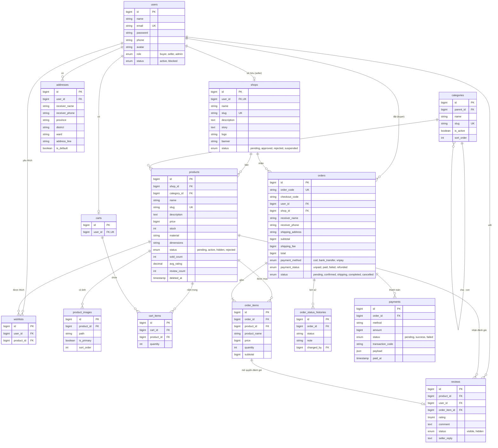

# ERD – Handmade & Art Products Marketplace

Sơ đồ viết bằng Mermaid. GitHub tự hiển thị được. Muốn xuất ảnh PNG/SVG cho báo cáo: dán nội dung khối `mermaid` vào https://mermaid.live rồi bấm Export.

## Các quyết định thiết kế (để trả lời khi thầy/cô hỏi)

| Quyết định | Lý do |
|---|---|
| 1 bảng `users` + cột `role` | Đơn giản, đủ cho 3 vai trò. Dữ liệu riêng của người bán nằm ở bảng `shops`. |
| `orders` tách theo shop, gom bằng `checkout_code` | Giỏ hàng có sản phẩm của nhiều nghệ nhân, mỗi người cần tự xác nhận và giao đơn của mình. |
| `order_items` lưu snapshot tên, giá | Sau này người bán sửa giá hoặc xóa sản phẩm thì đơn cũ vẫn đúng. |
| Giá dùng `unsignedBigInteger` (VND) | VND không có phần thập phân, tránh sai số của số thực. |
| `products` dùng soft delete | Xóa sản phẩm nhưng vẫn giữ được lịch sử đơn hàng và đánh giá. |
| `reviews` gắn với `order_item_id` | Chỉ người đã mua (đơn completed) mới đánh giá, mỗi lần mua một review (unique user + order_item). |
| `avg_rating`, `review_count`, `sold_count` trong `products` | Cột tổng hợp để sắp xếp và lọc nhanh, không phải tính lại mỗi lần. Cập nhật khi có review mới hoặc đơn completed. |
| `payments` tách riêng khỏi `orders` | Lưu log giao dịch và callback VNPay, một đơn có thể thanh toán thử nhiều lần. |
| `order_status_histories` | Phục vụ trang theo dõi đơn hàng của khách. |

## Quy ước giá trị enum (cả nhóm dùng đúng chuỗi này)

- `users.role`: `buyer`, `seller`, `admin`
- `shops.status`: `pending`, `approved`, `rejected`, `suspended`
- `products.status`: `pending`, `active`, `hidden`, `rejected` (khách chỉ thấy `active` của shop `approved`)
- `orders.status`: `pending` → `confirmed` → `shipping` → `completed`, hoặc `cancelled`
- `orders.payment_method`: `cod`, `bank_transfer`, `vnpay`
- `orders.payment_status`: `unpaid`, `paid`, `failed`, `refunded`

## Cách cài đặt

1. Copy các file trong thư mục `database/migrations/` của gói này vào dự án. **Xóa file migration users mặc định** (`0001_01_01_000000_create_users_table.php` hoặc `2014_10_12_000000_create_users_table.php` tùy phiên bản Laravel), vì file mới đã thay thế nó.
2. Copy `database/seeders/DatabaseSeeder.php` đè lên file cùng tên.
3. Tạo database trống trong phpMyAdmin (ví dụ `handmade_market`, collation `utf8mb4_unicode_ci`), chỉnh `.env` cho đúng.
4. Chạy: `php artisan migrate:fresh --seed`

Tài khoản mẫu (mật khẩu đều là `password`): `admin@example.com`, `seller@example.com`, `buyer@example.com`.

**Lưu ý:** nếu cả nhóm đã chạy migration cũ rồi thì dùng `migrate:fresh --seed` (xóa sạch rồi tạo lại). Khi cần thêm cột sau này, **tạo migration mới** bằng `php artisan make:migration add_xxx_to_yyy_table`, đừng sửa file cũ sau khi đã push.
